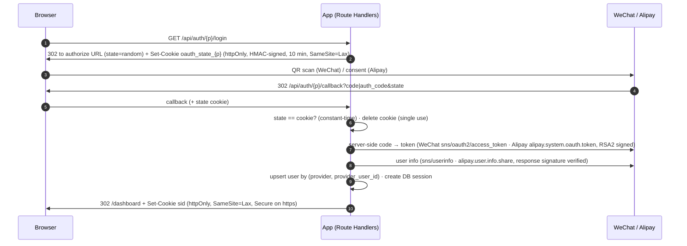
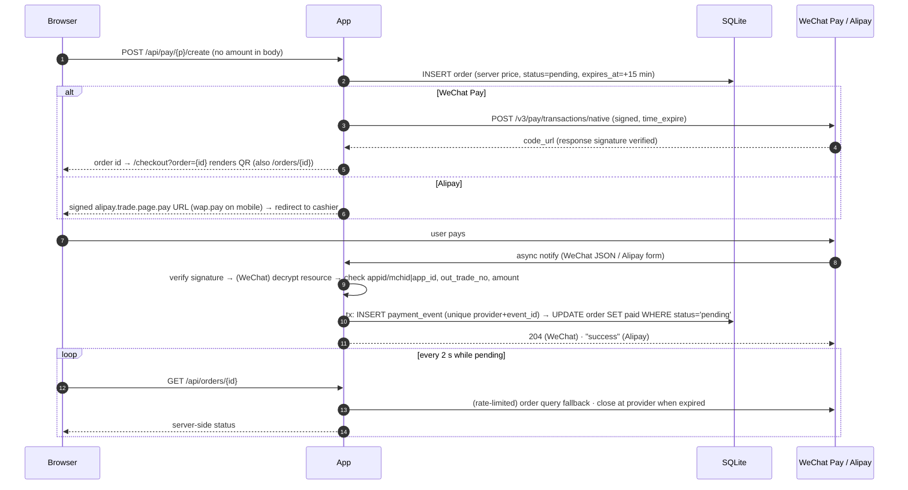

# Next.js × WeChat & Alipay — login and payment demo

A small Next.js (App Router, TypeScript strict) app where a user signs in with **WeChat** (website QR login) or **Alipay**, buys a fixed **0.01 CNY** test item with **WeChat Pay (API v3 Native)** or **Alipay (PC website payment, mobile web as bonus)**, and sees the order status change **only** when the server receives a verified asynchronous notification (or, as a fallback, a verified order query).

| Area | Status |
|---|---|
| WeChat login (QR, Open Platform website app) | implemented; **mock** by default (needs a company-verified account for real use) |
| Alipay login (`auth_user`) | implemented; mock or **Alipay sandbox** |
| WeChat Pay v3 Native (QR) | implemented incl. request signing, response verification, notify decryption; **mock** by default |
| Alipay `alipay.trade.page.pay` / `alipay.trade.wap.pay` | implemented; mock or **sandbox** |
| Notify handlers (signature, amount check, idempotency, exact reply format) | both providers, unit-tested |
| Order query fallback, 15-min expiry with provider-side close, 30 s background sweep (no page view needed) | both providers |
| Account linking (bonus) | yes — link the other provider from the dashboard |
| Docker (bonus) | `Dockerfile` included |

---

## 1. Quick start (mock mode, < 5 minutes)

Requirements: Node.js ≥ 20.9 (tested on 22), npm.

```bash
git clone <repo> && cd <repo>
cp .env.example .env.local
npm install
npm run dev            # → http://localhost:3000
```

That is all. Nothing else to configure in mock mode:

- the SQLite database (`dev.db`) is created and migrated automatically on first access;
- mock key pairs (merchant key, "WeChat Pay public key", APIv3 key, Alipay app key, "Alipay public key") are generated locally into `.mock-keys/` (git-ignored) on first use;
- a yellow **MOCK MODE · 模拟环境** strip on every page (login included) shows which providers are simulated.

Other scripts: `npm run lint`, `npm run typecheck`, `npm test`, `npm run build`, `npm run db:migrate`, `npm run db:generate`.

On Windows PowerShell with script execution disabled (`npm.ps1 … cannot be loaded`), run the same commands as `npm.cmd …`. No policy change is needed.

### What "mock" means here

Mock mode replaces **only the provider side**. Everything in the app runs exactly as in production:

- Login: `/api/auth/<p>/login` sets the state cookie and redirects to a local consent page (`/mock/oauth/<p>`) that sends the user back to the **same** callback route with a single-use code and the original `state`.
- WeChat Pay: the gateway returns a `weixin://wxpay/bizpayurl?pr=MOCK…` `code_url`, rendered as a QR code (with a "MOCK" seal). **Simulate payment success** (模拟支付成功) builds a real `TRANSACTION.SUCCESS` notification — resource encrypted with AEAD_AES_256_GCM using the APIv3 key, envelope signed with the mock platform private key — and **POSTs it over HTTP to `/api/pay/wechat/notify`**, so signature verification, decryption, amount check and idempotency are all exercised.
- Alipay: the app builds a fully RSA2-signed `alipay.trade.page.pay` URL; the mock cashier (`/mock/alipay/gateway`) **verifies the merchant signature** before showing the order. **Simulate payment success** (模拟付款成功) POSTs a form-encoded, RSA2-signed notification to `/api/pay/alipay/notify`. Order query / close / OAuth calls go through the real `AlipayClient` (signing + response-signature verification) with an in-process mock transport.
- **Replay last notification** (重放通知) re-sends the byte-identical notification to demonstrate idempotency. The mock tools panel logs the notify route's exact reply (`HTTP 204 ""` / `"success"`).

### UI

The interface is branded **MockPAY** and written in Chinese. It is a light B2B workspace: a sidebar on desktop and a bottom tab bar under 760px. Pages: login (`/`), console (`/dashboard`: stats from the user's own orders, account linking, recent orders), checkout (`/checkout`), order list with status tabs, search and channel filter (`/orders`), order detail (`/orders/[id]`), plus the mock consent screen and mock Alipay cashier. After a WeChat Pay order is created, the Native QR code is shown on `/checkout?order=<id>` itself, as the brief asks; the detail page shows it too.

---

## 2. Modes

`PAYMENT_MODE` sets the default for both providers; `WECHAT_MODE` / `ALIPAY_MODE` override it per provider. The typical review setup is:

```dotenv
PAYMENT_MODE=mock
ALIPAY_MODE=sandbox     # real Alipay sandbox
# WeChat stays mocked (no public sandbox, needs a verified company account)
```

Configuration is validated with Zod when the server starts (`instrumentation.ts`). If a provider is not in mock mode, every missing credential is listed at once and the process exits with a clear message.

Filling in a provider's credentials does not switch its mode: set `ALIPAY_MODE=sandbox` (or `WECHAT_MODE`) explicitly. `.env.local` is only read at start-up, so restart the server after editing it. The boot line `[config] OK — WeChat: …, Alipay: …, APP_URL=…` shows what is active.

| Mode | WeChat | Alipay |
|---|---|---|
| `mock` | local simulation | local simulation |
| `sandbox` | real API (WeChat Pay v3 has no sandbox; use the 0.01 CNY item) | `openapi-sandbox.dl.alipaydev.com` |
| `live` | real API | `openapi.alipay.com` |

---

## 3. Alipay sandbox setup

1. Sign in to the Alipay Open Platform with a personal account → **控制台 → 沙箱 (Sandbox)**. A sandbox app with an `APPID` is created automatically. → `ALIPAY_APP_ID`
2. **开发信息 → 接口加签方式**. The new sandbox enables **系统默认密钥** by default: under **公钥模式 → 查看**, copy the **应用私钥** → `ALIPAY_PRIVATE_KEY` (bare base64 or PEM; PKCS#8 and PKCS#1 both accepted). To use your own keys instead, choose **自定义密钥 → 公钥模式**, generate an RSA2 (2048) pair with the official *支付宝开放平台密钥工具*, upload the app public key and keep the app private key.
3. Copy the **支付宝公钥 (Alipay public key)** shown there — *not* your app public key. → `ALIPAY_PUBLIC_KEY`
4. Note the sandbox **seller/merchant PID (2088…)** if you want `seller_id` checked. → `ALIPAY_SELLER_ID` (optional; once set, every notification must carry exactly this value, so leave it empty unless you are sure)
5. Set the **授权回调地址 (authorisation redirect URI)** to `https://<your-tunnel>/api/auth/alipay/callback`. For user-info login the **domain** of `redirect_uri` must match this value, so update it whenever the tunnel host changes.
6. **沙箱账号**: note the sandbox **buyer** account and its login / payment password. Both the sandbox login page (tab **账密登录**) and the PC cashier accept it, so no phone is needed. The optional sandbox Alipay app (**沙箱工具**) runs on Android 7–13 only, not iOS or emulators; it is only needed to scan QR codes. Alipay picks the authorisation page by user agent: in a phone browser the sandbox serves its H5 flow, which only works inside that app ("请在支付宝客户端打开链接"). On an iPhone, sign in on a computer or request the desktop site; the login page says so on small screens.
7. In `.env.local`:

```dotenv
APP_URL=https://<your-tunnel-host>
ALIPAY_MODE=sandbox
ALIPAY_APP_ID=902100xxxxxxxxxx
ALIPAY_PRIVATE_KEY=MIIEvQIBADANBgkqhkiG9w0BAQEFAASC...
ALIPAY_PUBLIC_KEY=MIIBIjANBgkqhkiG9w0BAQEFAAOCAQ8A...
ALIPAY_GATEWAY=https://openapi-sandbox.dl.alipaydev.com/gateway.do
ALIPAY_AUTH_URL=https://openauth-sandbox.dl.alipaydev.com/oauth2/publicAppAuthorize.htm
```

> Both URLs match Alipay's current sandbox docs (environment upgrade notes and the 获取会员信息 sandbox guide, checked 2026-10-25). They stay configurable in case Alipay moves its sandbox domains again, as it did when it moved them to `*.dl.alipaydev.com`.

Keys never go into the repository: `.env*` (except `.env.example`), `certs/*`, `*.pem` and `.mock-keys/` are all git-ignored.

## 4. WeChat (live credentials, if the company provides them)

| Variable | Where it comes from |
|---|---|
| `WECHAT_APP_ID`, `WECHAT_APP_SECRET` | open.weixin.qq.com → website application (authorised callback domain must be your tunnel/host) |
| `WECHAT_PAY_MCH_ID`, `WECHAT_PAY_APP_ID` | merchant platform; the AppID must be bound to the merchant ID |
| `WECHAT_PAY_API_V3_KEY` | merchant platform → API security → APIv3 key (32 chars) |
| `WECHAT_PAY_CERT_SERIAL_NO`, `WECHAT_PAY_PRIVATE_KEY_PATH` | merchant API certificate serial and `apiclient_key.pem` → put it in `certs/` |
| `WECHAT_PAY_PLATFORM_PUBLIC_KEY_PATH`, `WECHAT_PAY_PLATFORM_PUBLIC_KEY_ID` | **微信支付公钥** and its ID (`PUB_KEY_ID_…`), which appears in the `Wechatpay-Serial` header |

Set `WECHAT_MODE=live` (or `sandbox`, which behaves the same) and use the 0.01 CNY item.

### Alipay live mode

1. On the Alipay Open Platform (production, not the sandbox), create a **网页/移动应用** under a company or individual merchant account and pass its review. Add the products **电脑网站支付** (and **手机网站支付** for the mobile bonus) plus **获取会员信息** for login, then sign the product agreements.
2. **开发信息 → 接口加签方式 → 自定义密钥 → 公钥模式**: generate an RSA2 (2048) key pair with the *支付宝开放平台密钥工具*, upload the app public key, keep the app private key → `ALIPAY_PRIVATE_KEY`; copy the shown **支付宝公钥** → `ALIPAY_PUBLIC_KEY`. Production apps have no system default keys.
3. Set the **授权回调地址** to `https://<your-domain>/api/auth/alipay/callback` and note the APPID → `ALIPAY_APP_ID` and the merchant PID (2088…) → `ALIPAY_SELLER_ID` (optional).
4. In `.env.local`: `ALIPAY_MODE=live`, `ALIPAY_GATEWAY=https://openapi.alipay.com/gateway.do`, `ALIPAY_AUTH_URL=https://openauth.alipay.com/oauth2/publicAppAuthorize.htm`, and an `APP_URL` on a public HTTPS domain so notifications reach `/api/pay/alipay/notify`. Restart and check the boot line shows `Alipay: live`.
5. Test with the 0.01 CNY item; real money moves. No code changes are needed between sandbox and live.

## 5. Exposing callbacks with a tunnel

Providers cannot call `localhost`. Expose port 3000 and use the public URL as `APP_URL`:

```bash
# ngrok
ngrok http 3000                       # → https://abcd-1234.ngrok-free.app
# or Cloudflare quick tunnel
cloudflared tunnel --url http://localhost:3000   # → https://xxx.trycloudflare.com
```

Then set `APP_URL=https://…` in `.env.local` and restart `npm run dev`. `WECHAT_PAY_NOTIFY_URL`, `ALIPAY_NOTIFY_URL` and `ALIPAY_RETURN_URL` expand `${APP_URL}` automatically. Open the app **through the tunnel URL** (cookies are bound to that origin; with https the session cookie becomes `__Host-sid` + `Secure`). Register the same host as the callback domain in each provider console.

`next dev` only serves its dev assets to localhost; requests from any other host get `403`, which leaves pages without their scripts. `next.config.ts` therefore adds the host of `APP_URL` to `allowedDevOrigins`. A new tunnel host only needs a new `APP_URL` and a restart. The Cloudflare quick tunnel gets a new host on every run; ngrok's free tier shows a one-time browser warning page on its domain.

---

## 6. Flows

### Login (both providers)



Signing in again with the same identity reuses the local user and refreshes its name and avatar: the dashboard's main profile follows the identity used for the most recent sign-in. Linking a second provider only adds that identity's `accounts` row, and an empty or missing field from the provider never clears a stored value.

For Alipay, the signed `alipay.system.oauth.token` response is the identity. Nickname and avatar come from a separate member-info service (`alipay.user.info.share`). If that call fails (the sandbox returns `aop.unknow-error` at times), login still completes, `auth.profile_unavailable` is logged, and the next successful login fills the profile in. A failed `auth_code` exchange never signs anyone in. Every gateway call logs `alipay.api_call` with its method and latency, without parameters or tokens.

### Payment



The browser redirect (Alipay `return_url`, or any client state) is **never** used to mark an order paid; `/orders?out_trade_no=…` only finds the order page.

Nobody has to keep the order page open: a background sweep started at boot (`instrumentation-node.ts` → `startOrderSweeper`, every 30 s) closes overdue orders at the provider and locally, and queries the remaining pending ones to recover missed notifications. The console and order list also close the user's overdue orders before rendering, so they never show an expired order as pending.

---

## 7. Security design

- **Signature verification**
  - WeChat Pay: `Wechatpay-Timestamp\nWechatpay-Nonce\nbody\n`, SHA256withRSA against the WeChat Pay public key; `Wechatpay-Serial` must equal the configured key ID; timestamps older than 5 minutes are rejected (replay); `WECHATPAY/SIGNTEST/` probe signatures fail as required. Successful **API responses** are verified the same way, not only notifications. Resource decryption is AEAD_AES_256_GCM with the APIv3 key (tag = last 16 bytes).
  - Alipay: notifications — drop `sign` and `sign_type`, sort, `k=v&…`, RSA2 against the **Alipay** public key; synchronous responses — signature over the exact raw JSON text of `<method>_response` (extracted without re-serialising).
- **Business checks after a valid signature**: provider merchant identity (appid + mchid / app_id + optional seller_id), currency, `out_trade_no` exists for that provider, amount equals the stored integer-fen amount (parsed from strings, never floats).
- **Idempotency**: in one SQLite transaction, `INSERT … ON CONFLICT DO NOTHING` into `payment_events(provider, event_id)` (WeChat notification `id`, Alipay `notify_id`, or `query:<out_trade_no>:<state>`), then `UPDATE orders … WHERE status = 'pending'`. A duplicate or concurrent event can never change an order twice; every outcome (`applied/duplicate/ignored/rejected`) is logged.
- **Reply formats**: WeChat 204 (no body) on success, 4xx + `{"code":"FAIL","message":…}` on verification failure; Alipay plain text `success` / `fail`. A *validly signed but inconsistent* notification (e.g. amount mismatch) is acknowledged — retries would not change it — and recorded as `rejected` with an error log for follow-up.
- **No trust in the browser**: price comes from `lib/catalog.ts`; create endpoints ignore the request body; status only changes from verified provider data.
- **Sessions**: opaque 256-bit token in an httpOnly, SameSite=Lax cookie (`__Host-` + Secure on https); only `HMAC(SESSION_SECRET, token)` is stored; logout deletes the DB row (real revocation) and is POST-only.
- **CSRF**: OAuth `state` (signed cookie, single use, constant-time compare); state-changing JSON endpoints require a same-origin `Origin` / `Sec-Fetch-Site`.
- **Authorisation**: users can only read/close their own orders (`WHERE id = ? AND user_id = ?`).
- **Secrets**: all signing, token exchange and verification run in Route Handlers / server modules (`server-only`); logs contain codes and redacted identifiers, never keys, tokens or signatures.

## 8. Decisions

- **Hand-rolled sessions instead of Auth.js.** Both providers deviate from standard OAuth 2.0/OIDC (WeChat: `appid`/`secret` query params, `#wechat_redirect`, `openid` in the token response; Alipay: `app_id`, `auth_code`, every call is an RSA2-signed gateway request). Wrapping them as Auth.js custom providers would mean overriding token *and* userinfo requests anyway, while hiding the state check the task asks to show. ~150 lines of explicit code (`lib/auth/*`) keep the CSRF and cookie logic reviewable, and DB sessions give real logout.
- **No third-party payment SDKs.** WeChat Pay has no official Node.js SDK; for symmetry Alipay signing is also implemented on `node:crypto`, which lets mock mode run the exact same code and makes the crypto unit-testable.
- **Drizzle + SQLite (libSQL driver).** libSQL ships prebuilt binaries as optional npm packages, so `npm install` works on a fresh machine without compilers (better-sqlite3 fell back to `node-gyp` in testing). Write transactions are serialised in-process (`withWriteTransaction`, `BEGIN IMMEDIATE`) and the idempotency guarantee itself comes from the unique event index + conditional update. Migrations live in `drizzle/` and are applied automatically on first access.

### Libraries

| Package | Why |
|---|---|
| `next` 16, `react` 19 | framework |
| `drizzle-orm`, `drizzle-kit`, `@libsql/client` | ORM, migrations, SQLite driver (prebuilt binaries per platform — no C/C++ toolchain needed for `npm install`) |
| `zod` | env validation, request body validation |
| `qrcode` | render WeChat `code_url` as a QR image (server-side) |
| `server-only` | build-time guard against importing server modules into client code |
| `vitest`, `eslint` + `eslint-config-next`, `typescript`, `tsx` | tests, lint, type-check, migration script |

## 9. Project structure

```
app/
  api/auth/{wechat,alipay}/{login,callback}/route.ts   OAuth start + callback
  api/auth/logout/route.ts
  api/pay/{wechat,alipay}/create/route.ts              create order → provider
  api/pay/{wechat,alipay}/notify/route.ts              async notifications (thin wrappers)
  api/orders/[id]/route.ts, [id]/close/route.ts        polling + cancel
  api/mock/...                                         mock-provider endpoints (mock mode only)
  page.tsx                                             login (full-screen, no workspace shell)
  (workspace)/layout.tsx                               signed-in shell: sidebar, top bar, environment strip
  (workspace)/{dashboard,checkout,orders,orders/[id],mock/...}/page.tsx
components/
  shell/                    AppShell, navigation, per-provider environment strip
  ui/                       icons, primitives (badge, money, steps…), native <dialog> modal
  CheckoutClient.tsx        channel choice, order summary, Alipay redirect step
  OrderPage.tsx, OrderStatusClient.tsx  QR, countdown, server polling, cancel, results, mock tools
  OrdersBrowser.tsx         status tabs, search, channel filter, pagination
lib/
  env.ts                    Zod config, per-provider modes
  db/schema.ts, db/index.ts users, accounts, sessions, orders, payment_events (+ mock tables)
  auth/                     session, oauth-state, users (upsert/link), login-flow
  wechat/pay-crypto.ts      v3 signing, verification, AES-GCM  (pure, tested)
  wechat/pay-client.ts      Native / query / close (HTTP + mock gateway)
  wechat/oauth.ts           QR login
  alipay/sign.ts            RSA2 sign / verify notify / verify response  (pure, tested)
  alipay/client.ts          page.pay, wap.pay, query, close, oauth.token, user.info.share
  payments/orders.ts        state machine + idempotent applyVerifiedEvent
  payments/{wechat,alipay}.ts  notify handlers (framework-agnostic, tested)
  payments/sync.ts          query fallback, expiry, close, expireOverdueOrders / sweepPendingOrders
  payments/sweeper.ts       30 s background sweep started from instrumentation
  mock/                     mock keys + mock provider behaviour
tests/                      57 unit tests (signatures, decryption, notify handlers, idempotency, expiry, sweep, profiles, Alipay login fallback, env)
drizzle/                    SQL migrations
```

## 10. Tests

`npm test` runs offline against a throw-away SQLite file:

- WeChat: Authorization header format, request-signature verifiability, notification verification (tampered body, foreign key, unknown serial, stale timestamp, missing headers, sign probe), AES-GCM round-trip and authentication failures.
- Alipay: sign-content construction (incl. the example string from Alipay's documentation), RSA2 notify verification (tampering, app-key forgery, non-RSA2, missing sign, form round-trip with non-ASCII), response-node extraction and verification.
- Notify handlers: paid + exact reply, **same notification twice → one update**, **5 concurrent deliveries → one update**, second distinct notification ignored, bad signature leaves order pending, amount mismatch rejected, Alipay `TRADE_CLOSED`, Alipay `seller_id` missing or foreign → `fail` (validly signed).
- Users: re-login updates the same local user's profile, missing fields keep stored values, linking leaves the main profile alone.
- Alipay login: profile from token + member info, login still succeeds when member info fails (stored nickname kept, new users get a placeholder), a failed `auth_code` exchange does not sign in.
- Fallbacks: lost notification recovered by query, `PAYERROR → failed`, expiry closes at provider and locally, payment that lands before close wins.
- Without a page view: overdue orders of both providers are closed (Alipay even if the cashier was never opened), orders within TTL and paid orders are untouched, user-scoped expiry leaves other users' orders to the sweep, and the sweep recovers a missed notification.

## 11. Demo video checklist

1. Fresh clone → `cp .env.example .env.local` → `npm install && npm run dev` (show the config line in the terminal).
2. Login with WeChat (**mock**) and with Alipay (**sandbox**, or mock — say which).
3. Alipay sandbox order → cashier → pay with the sandbox buyer.
4. WeChat Pay order (mock) → QR on `/checkout` → *模拟支付成功* (simulate payment success).
5. Status flips to **paid** via the notification; show the `orders` and `payment_events` rows (`sqlite3 dev.db 'select * from payment_events'` or Drizzle Studio: `npx drizzle-kit studio`). Point at the row with `source = notify`. If its outcome is `ignored`, the order query (page poll or sweep) arrived first, and the notification was still verified.
6. Failure / cancel: *模拟支付失败* (WeChat → `failed` via query), *取消订单* (→ `closed`), and *重放通知* (stays paid, no double update).
7. Walk through `lib/payments/wechat.ts → handleWechatNotify` and `lib/payments/orders.ts → applyVerifiedEvent`.

Never show `.env.local` or `.mock-keys/` in the recording. Record the Alipay part in a private window. Alipay remembers its own login and earlier consent, so in a normal window it may send you straight back without showing its login page. Logging out of MockPAY does not log you out of Alipay.

## 12. Known limitations / next steps

- WeChat login and Pay are only exercised in mock mode here; the real HTTP paths follow the official v3 docs but were not run against live credentials.
- Only the **WeChat Pay public key** verification mode is supported, not the legacy downloadable *platform certificate* mode (would need `/v3/certificates` download + rotation).
- The expiry / reconciliation sweep is an in-process timer (`lib/payments/sweeper.ts`, every 30 s), which suits this single Node.js process. With several instances or a serverless host, move it to one scheduled job (cron) calling `sweepPendingOrders()`.
- A pending Alipay order cannot reopen the cashier from its detail page (the signed pay URL is not regenerated); the user can cancel it and buy again.
- Single-process SQLite; for multiple instances move to Postgres and keep the same transactional pattern.
- No rate limiting on login/notify endpoints; notify IP allow-listing not implemented.
- Not in scope: refunds, JSAPI / in-WeChat browser login (bonus), Mini Programs.
- Provider-side issues that are not caused by this code (why WeChat runs in mock mode, the Alipay sandbox member-info outage) are documented with evidence in [KNOWN_ISSUES.zh-CN.md](KNOWN_ISSUES.zh-CN.md).
- Alipay sandbox, verified end to end through a Cloudflare tunnel on 2026-10-25 (times UTC, evidence from `orders` / `payment_events` in `dev.db`):
  - **Login:** the `state` check, `auth_code` → token and sign-in all work. The sandbox member-info service (`alipay.user.info.share`) kept answering `aop.unknow-error`, so the fallback signed users in without nickname or avatar; they fill in once that service recovers.
  - **Payment:** order `d55b2a3a…` (0.01 CNY) was created at 17:06:36 and paid in the sandbox cashier with the buyer account. Alipay's async notification reached the tunnel, passed RSA2 verification and was recorded as `source = notify`, `event_type = TRADE_SUCCESS`, `outcome = applied`; the order became `paid` with `paid_at` 17:06:51. The 28-digit trade number (`20261026…`) and the 34-character `notify_id` (`2026102601…`) have Alipay's real formats, not the mock's.
  - **Expiry:** order `213c4495…` opened the cashier and was left unpaid. About 23 s after its 15-minute deadline it closed through the order query (`QUERY.TRADE_CLOSED`, `applied`).
  - **Not yet run in the sandbox:** a user-initiated cancel (`alipay.trade.close` on a live trade) and mobile web payment (`alipay.trade.wap.pay`, bonus).

## Docker

```bash
docker build -t pay-demo .
docker run --rm -p 3000:3000 --env-file .env.local pay-demo
```

## References

- WeChat website app login: https://developers.weixin.qq.com/doc/oplatform/developers/dev/auth/web.html
- WeChat Pay Native order (v3): https://pay.weixin.qq.com/doc/v3/merchant/4012791877
- WeChat Pay notifications (verify, decrypt, reply, retries): https://pay.weixin.qq.com/docs/merchant/products/notification/introduction.html
- WeChat Pay resource decryption: https://pay.weixin.qq.com/docs/partner/products/notification/decryption.html
- Alipay async notification signature string: https://global.alipay.com/doc/web/async
- Alipay user authorisation (`publicAppAuthorize`, `alipay.system.oauth.token`): https://global.alipay.com/doc/3rdpartryqrcode/standard_2
- Alipay sandbox (quick start, constraints, supported products, upgrade notes): https://opendocs.alipay.com/common/02kkv7
- Alipay sandbox debugging for 获取会员信息 (sandbox authorise URL): https://opendocs.alipay.com/open/09byox
- Next.js `allowedDevOrigins`: `node_modules/next/dist/docs/01-app/03-api-reference/05-config/01-next-config-js/allowedDevOrigins.md`
