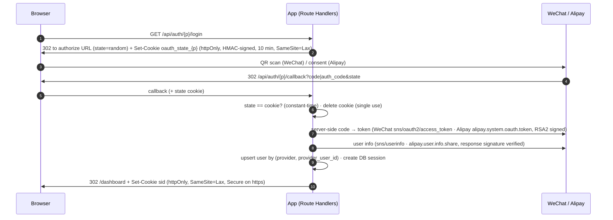
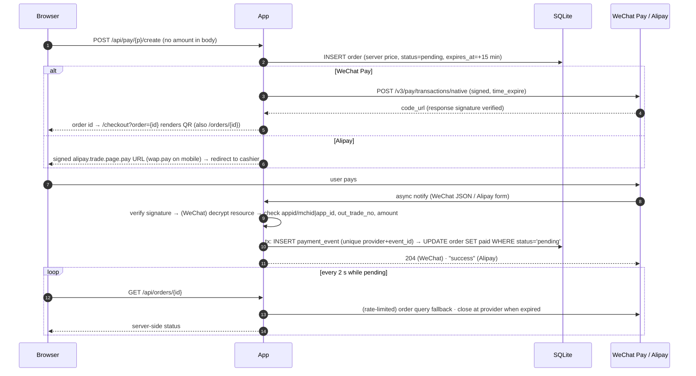

# Next.js × 微信 & 支付宝 — 登录与支付演示

[English](README.md) | **简体中文**

**演示视频：** https://youtu.be/1UNmihguaSg ——微信使用 Mock 模式，支付宝使用真实沙箱。

一个小型 Next.js 应用（App Router，TypeScript strict）：用户可以用**微信**（网站扫码登录）或**支付宝**登录，然后用**微信支付（API v3 Native）**或**支付宝（电脑网站支付；手机网站支付为加分项）**购买一件固定价格 **0.01 元**的测试商品。订单状态**只会**在服务端收到并验证通过异步通知后才改变；作为兜底，也可以由验证通过的主动查单结果改变。

| 功能 | 状态 |
|---|---|
| 微信登录（扫码，开放平台网站应用） | 已实现；默认 **Mock**（真实使用需要企业认证账号） |
| 支付宝登录（`auth_user`） | 已实现；Mock 或**支付宝沙箱** |
| 微信支付 v3 Native（二维码） | 已实现，包括请求签名、响应验签、通知解密；默认 **Mock** |
| 支付宝 `alipay.trade.page.pay` / `alipay.trade.wap.pay` | 已实现；Mock 或**沙箱** |
| 通知处理（验签、金额核对、幂等、严格的回复格式） | 两个渠道均已实现，有单元测试 |
| 主动查单兜底、15 分钟过期并在渠道侧关单、每 30 秒后台清扫（无需打开页面） | 两个渠道 |
| 账号关联（加分项） | 支持，可在控制台关联另一个渠道 |
| Docker（加分项） | 提供 `Dockerfile` |

---

## 1. 快速开始（Mock 模式，5 分钟内）

环境要求：Node.js ≥ 20.9（已在 22 上测试）、npm。

```bash
git clone <repo> && cd <repo>
cp .env.example .env.local
npm install
npm run dev            # → http://localhost:3000
```

就这么多。Mock 模式下不需要任何其他配置：

- 第一次访问时，会自动创建 SQLite 数据库（`dev.db`）并执行迁移；
- 第一次使用时，会在本地 `.mock-keys/`（已被 git 忽略）生成 Mock 密钥对：商户密钥、“微信支付公钥”、APIv3 密钥、支付宝应用密钥、“支付宝公钥”；
- 每个页面（包括登录页）顶部都有黄色的 **MOCK MODE · 模拟环境**提示条，标明哪些渠道是模拟的。

其他脚本：`npm run lint`、`npm run typecheck`、`npm test`、`npm run build`、`npm run db:migrate`、`npm run db:generate`。

如果 Windows PowerShell 禁止运行脚本（提示 `npm.ps1 … 因为在此系统上禁止运行脚本`），把命令里的 `npm` 换成 `npm.cmd` 即可，不需要修改执行策略。

### 这里的 “Mock” 指什么

Mock 模式**只替换渠道一侧**，应用本身的代码和生产环境完全一样：

- **登录：** `/api/auth/<p>/login` 写入 state Cookie，然后跳转到本地授权页（`/mock/oauth/<p>`）。该页面带着一次性的 code 和原始的 `state`，跳回**同一个**回调路由。
- **微信支付：** 网关返回 `weixin://wxpay/bizpayurl?pr=MOCK…` 形式的 `code_url`，页面将其渲染成二维码（中间带 “MOCK” 标记）。点击**模拟支付成功**时，会构造一条真实格式的 `TRANSACTION.SUCCESS` 通知：资源用 APIv3 密钥做 AEAD_AES_256_GCM 加密，外层用 Mock 平台私钥签名，然后**通过 HTTP POST 到 `/api/pay/wechat/notify`**。因此验签、解密、金额核对和幂等处理都会真实执行。
- **支付宝：** 应用生成完整 RSA2 签名的 `alipay.trade.page.pay` 跳转地址。Mock 收银台（`/mock/alipay/gateway`）会先**验证商户签名**，通过后才显示订单。点击**模拟付款成功**时，会把一条表单编码、RSA2 签名的通知 POST 到 `/api/pay/alipay/notify`。查单、关单和 OAuth 调用都经过真实的 `AlipayClient`（包括签名和响应验签），只是底层传输换成了进程内的 Mock 实现。
- **重放通知：** 把上一条通知按字节原样再发送一次，用来演示幂等。Mock 工具区会显示通知接口的原始回复（`HTTP 204 ""` 或 `"success"`）。

### 界面

界面品牌为 **MockPAY**，文案为中文，是一个浅色的 B 端工作台：桌面端为侧栏布局，宽度小于 760px 时改为底部导航。页面包括：

- 登录页（`/`）；
- 控制台（`/dashboard`）：本人订单统计、账号关联、最近订单；
- 结账页（`/checkout`）；
- 订单列表（`/orders`）：状态页签、搜索、渠道筛选；
- 订单详情（`/orders/[id]`）；
- Mock 授权页和 Mock 支付宝收银台。

创建微信支付订单后，Native 二维码会按任务要求直接显示在 `/checkout?order=<id>` 上，订单详情页同样会显示。

---

## 2. 运行模式

`PAYMENT_MODE` 设置两个渠道的默认模式，`WECHAT_MODE` / `ALIPAY_MODE` 可以分别覆盖单个渠道。评审时的典型配置：

```dotenv
PAYMENT_MODE=mock
ALIPAY_MODE=sandbox     # 真实支付宝沙箱
# 微信保持 Mock（没有公开沙箱，并且需要企业认证账号）
```

服务启动时用 Zod 校验配置（`instrumentation.ts`）。如果某个渠道不是 Mock 模式，所有缺失的凭据会一次性列出，进程随后退出并给出明确的提示。

只填写渠道凭据并不会切换模式，必须显式设置 `ALIPAY_MODE=sandbox`（或 `WECHAT_MODE`）。`.env.local` 只在启动时读取，修改后要重启服务。启动日志里的 `[config] OK — WeChat: …, Alipay: …, APP_URL=…` 会显示当前生效的配置。

| 模式 | 微信 | 支付宝 |
|---|---|---|
| `mock` | 本地模拟 | 本地模拟 |
| `sandbox` | 真实接口（微信支付 v3 没有沙箱，请使用 0.01 元商品） | `openapi-sandbox.dl.alipaydev.com` |
| `live` | 真实接口 | `openapi.alipay.com` |

---

## 3. 支付宝沙箱配置

1. 用个人支付宝账号登录支付宝开放平台，进入**控制台 → 沙箱**。系统会自动创建一个带 `APPID` 的沙箱应用。→ `ALIPAY_APP_ID`
2. 进入**开发信息 → 接口加签方式**。新版沙箱默认启用**系统默认密钥**：在**公钥模式 → 查看**里复制**应用私钥** → `ALIPAY_PRIVATE_KEY`。裸 base64 或 PEM 都可以，PKCS#8 和 PKCS#1 也都支持。如果想用自己的密钥，选择**自定义密钥 → 公钥模式**，用官方的*支付宝开放平台密钥工具*生成 RSA2（2048）密钥对，上传应用公钥，保留应用私钥。
3. 复制同一处显示的**支付宝公钥**，注意*不是*你的应用公钥。→ `ALIPAY_PUBLIC_KEY`
4. 如果需要校验 `seller_id`，记下沙箱**商家 PID（2088…）** → `ALIPAY_SELLER_ID`。这一项是可选的：一旦填写，每条通知都必须带上完全相同的值，所以没有把握的话请留空。
5. 把**授权回调地址**设为 `https://<你的隧道域名>/api/auth/alipay/callback`。获取用户信息时，`redirect_uri` 的**域名**必须和这里配置的一致，所以隧道域名每次变化都要同步更新。
6. **沙箱账号：** 记下沙箱**买家**账号及其登录密码、支付密码。沙箱登录页（**账密登录**选项卡）和电脑收银台都可以直接用这个账号，不需要手机。可选的沙箱版支付宝 App（在**沙箱工具**中下载）只支持 Android 7–13，不支持 iOS 和模拟器，只有扫码时才需要。支付宝会根据浏览器 UA 选择授权页：在手机浏览器里，沙箱会走 H5 流程，而这个流程只能在沙箱 App 里完成（页面提示“请在支付宝客户端打开链接”）。iPhone 用户请在电脑上登录，或者在浏览器里请求桌面版网站；登录页在小屏幕上也会提示这一点。
7. 在 `.env.local` 中填写：

```dotenv
APP_URL=https://<your-tunnel-host>
ALIPAY_MODE=sandbox
ALIPAY_APP_ID=902100xxxxxxxxxx
ALIPAY_PRIVATE_KEY=MIIEvQIBADANBgkqhkiG9w0BAQEFAASC...
ALIPAY_PUBLIC_KEY=MIIBIjANBgkqhkiG9w0BAQEFAAOCAQ8A...
ALIPAY_GATEWAY=https://openapi-sandbox.dl.alipaydev.com/gateway.do
ALIPAY_AUTH_URL=https://openauth-sandbox.dl.alipaydev.com/oauth2/publicAppAuthorize.htm
```

> 这两个地址已在 2026-10-25 对照支付宝当前的沙箱文档（《环境升级说明》和《获取会员信息 · 沙箱调试说明》）核对过。之所以保持可配置，是因为支付宝曾经迁移过沙箱域名（迁到了 `*.dl.alipaydev.com`），以后也可能再变。

密钥不会进入仓库：`.env*`（`.env.example` 除外）、`certs/*`、`*.pem` 和 `.mock-keys/` 都已被 git 忽略。

## 4. 正式环境

### 微信（如果公司能提供正式凭据）

| 变量 | 来源 |
|---|---|
| `WECHAT_APP_ID`、`WECHAT_APP_SECRET` | open.weixin.qq.com → 网站应用（授权回调域必须是你的隧道域名或正式域名） |
| `WECHAT_PAY_MCH_ID`、`WECHAT_PAY_APP_ID` | 商户平台；该 AppID 必须与商户号绑定 |
| `WECHAT_PAY_API_V3_KEY` | 商户平台 → API 安全 → APIv3 密钥（32 位） |
| `WECHAT_PAY_CERT_SERIAL_NO`、`WECHAT_PAY_PRIVATE_KEY_PATH` | 商户 API 证书序列号和 `apiclient_key.pem`，文件放在 `certs/` 目录 |
| `WECHAT_PAY_PLATFORM_PUBLIC_KEY_PATH`、`WECHAT_PAY_PLATFORM_PUBLIC_KEY_ID` | **微信支付公钥**及其 ID（`PUB_KEY_ID_…`），这个 ID 会出现在 `Wechatpay-Serial` 请求头里 |

设置 `WECHAT_MODE=live`（设为 `sandbox` 效果相同），然后用 0.01 元商品测试。

### 支付宝正式环境

1. 在支付宝开放平台的正式环境（不是沙箱）中，以企业或个体商户身份创建**网页/移动应用**并通过审核。添加**电脑网站支付**产品（如需手机支付加分项，再加**手机网站支付**），登录功能需要添加**获取会员信息**，然后签约这些产品。
2. 进入**开发信息 → 接口加签方式 → 自定义密钥 → 公钥模式**：用*支付宝开放平台密钥工具*生成 RSA2（2048）密钥对，上传应用公钥，保留应用私钥 → `ALIPAY_PRIVATE_KEY`；复制页面上显示的**支付宝公钥** → `ALIPAY_PUBLIC_KEY`。正式应用没有系统默认密钥。
3. 把**授权回调地址**设为 `https://<你的域名>/api/auth/alipay/callback`；记下 APPID → `ALIPAY_APP_ID`，商家 PID（2088…）→ `ALIPAY_SELLER_ID`（可选）。
4. 在 `.env.local` 中设置：
   - `ALIPAY_MODE=live`
   - `ALIPAY_GATEWAY=https://openapi.alipay.com/gateway.do`
   - `ALIPAY_AUTH_URL=https://openauth.alipay.com/oauth2/publicAppAuthorize.htm`
   - `APP_URL` 使用公网 HTTPS 域名，确保通知能送达 `/api/pay/alipay/notify`

   重启后，确认启动日志显示 `Alipay: live`。
5. 用 0.01 元商品测试，会产生真实扣款。从沙箱切换到正式环境不需要改代码。

## 5. 用隧道暴露回调地址

渠道服务器访问不到 `localhost`。需要把 3000 端口暴露到公网，并把公网地址设为 `APP_URL`：

```bash
# ngrok
ngrok http 3000                       # → https://abcd-1234.ngrok-free.app
# 或者 Cloudflare 临时隧道
cloudflared tunnel --url http://localhost:3000   # → https://xxx.trycloudflare.com
```

然后在 `.env.local` 里设置 `APP_URL=https://…`，并重启 `npm run dev`。`WECHAT_PAY_NOTIFY_URL`、`ALIPAY_NOTIFY_URL` 和 `ALIPAY_RETURN_URL` 会自动展开 `${APP_URL}`。请**通过隧道地址**打开应用：Cookie 绑定在这个域名上，使用 https 时会话 Cookie 会变成 `__Host-sid` 并带上 `Secure`。在各渠道控制台把同一个域名登记为回调域。

`next dev` 只向 localhost 提供开发资源，来自其他域名的请求会返回 `403`，导致页面脚本无法加载。所以 `next.config.ts` 会把 `APP_URL` 的域名加入 `allowedDevOrigins`。隧道域名变化后，只需要修改 `APP_URL` 并重启。Cloudflare 临时隧道每次启动都会分配新域名；ngrok 免费版第一次访问时会显示一个浏览器提示页。

---

## 6. 流程

### 登录（两个渠道相同）



1. 浏览器访问 `/api/auth/{p}/login`；
2. 服务端生成随机 state，写入 HMAC 签名、httpOnly 的 state Cookie，然后跳转到渠道授权页；
3. 用户在渠道侧完成扫码或授权；
4. 渠道带着 code（或 auth_code）和 state 跳回回调地址；
5. 服务端用常量时间比较 state 和 Cookie，并删除 Cookie，保证只能使用一次；
6. 服务端用 code 换取令牌，再获取用户信息；
7. 按“渠道 + 渠道用户 ID”创建或更新本地用户，创建数据库会话；
8. 写入会话 Cookie，跳转到控制台。

用同一身份再次登录时，会复用原来的本地用户，并刷新名称和头像：控制台显示的主资料跟随最近一次登录所用的身份。关联第二个渠道时只会新增该身份的 `accounts` 记录。渠道返回的字段为空或缺失时，不会清空已保存的值。

对支付宝来说，经过签名的 `alipay.system.oauth.token` 响应就是身份凭证；昵称和头像来自另一个会员信息服务（`alipay.user.info.share`）。如果这次调用失败（沙箱有时会返回 `aop.unknow-error`），登录仍会完成，并记录 `auth.profile_unavailable` 日志，下次登录成功时再补全资料。`auth_code` 换取令牌失败时，一律不允许登录。每次网关调用都会记录一条 `alipay.api_call` 日志，只包含接口名和耗时，不记录参数和令牌。

### 支付



1. 浏览器请求创建订单，请求体中不带金额；
2. 服务端先以服务端价格写入一条 pending 订单，15 分钟后过期；
3. 微信：调用 Native 下单拿到 `code_url`，在 `/checkout?order={id}` 显示二维码。支付宝：生成签名跳转地址，跳转到收银台（手机上使用 wap.pay）；
4. 用户付款后，渠道发送异步通知；
5. 服务端验签（微信还要解密），核对商户身份、订单号和金额；
6. 在同一个事务中插入事件记录（按“渠道 + 事件 ID”唯一），再以 `status='pending'` 为条件把订单更新为已支付；
7. 按渠道要求回复：微信回复 204，支付宝回复 `"success"`；
8. 订单待支付期间，页面每 2 秒查询一次服务端状态。服务端会限频地主动查单兜底，订单过期时在渠道侧关单。

浏览器跳转（支付宝的 `return_url`，或任何客户端状态）**永远**不会用来把订单标记为已支付；`/orders?out_trade_no=…` 只用于找到对应的订单页面。

订单页面不需要一直开着：服务启动时会开启一个后台清扫任务（`instrumentation-node.ts` → `startOrderSweeper`，每 30 秒运行一次）。它会在渠道侧和本地关闭过期订单，并对其余待支付订单主动查单，补上丢失的通知。控制台和订单列表在渲染前也会先关闭当前用户已过期的订单，所以不会把过期订单显示为待支付。

---

## 7. 安全设计

- **验签**
  - **微信支付：** 签名串为 `Wechatpay-Timestamp\nWechatpay-Nonce\nbody\n`，用微信支付公钥做 SHA256withRSA 验证；`Wechatpay-Serial` 必须与配置的公钥 ID 一致；时间戳超过 5 分钟的请求一律拒绝（防重放）；`WECHATPAY/SIGNTEST/` 探测签名按要求返回失败。不只是通知，成功的 **API 响应**也用同样的方式验签。资源解密使用 APIv3 密钥做 AEAD_AES_256_GCM，认证标签为最后 16 字节。
  - **支付宝：** 通知验签时，去掉 `sign` 和 `sign_type`，其余参数排序后拼成 `k=v&…`，用**支付宝**公钥做 RSA2 验证。同步响应验签时，签名覆盖的是 `<method>_response` 节点的原始 JSON 文本，提取时不做重新序列化。
- **验签通过后的业务核对：** 渠道商户身份（appid + mchid，或 app_id + 可选的 seller_id）、币种、该渠道下 `out_trade_no` 是否存在、金额是否等于存储的整数“分”。金额从字符串解析，从不使用浮点数。
- **幂等：** 在同一个 SQLite 事务中，先执行 `INSERT … ON CONFLICT DO NOTHING` 写入 `payment_events(provider, event_id)`，事件 ID 分别是微信通知的 `id`、支付宝的 `notify_id` 或查单得到的 `query:<out_trade_no>:<state>`；再执行 `UPDATE orders … WHERE status = 'pending'`。重复或并发到达的事件永远不会让订单被修改两次。每种处理结果（`applied`/`duplicate`/`ignored`/`rejected`）都会记录日志。
- **回复格式：** 微信成功时回复 204（无正文），验签失败时回复 4xx 加 `{"code":"FAIL","message":…}`；支付宝回复纯文本 `success` 或 `fail`。对于*签名有效但内容不一致*的通知（例如金额不符），会正常确认接收（重试也不会改变结果），同时记为 `rejected` 并写错误日志，便于后续跟进。
- **不信任浏览器：** 价格来自 `lib/catalog.ts`，下单接口忽略请求体，订单状态只由验证通过的渠道数据改变。
- **会话：** httpOnly、SameSite=Lax 的 Cookie 中存放 256 位不透明令牌（https 下使用 `__Host-` 前缀并带 Secure）；数据库只存 `HMAC(SESSION_SECRET, token)`；退出登录只接受 POST，并删除数据库中的会话记录，真正吊销会话。
- **CSRF：** OAuth `state` 使用签名 Cookie，一次性有效，常量时间比较；会修改状态的 JSON 接口要求同源的 `Origin` 或 `Sec-Fetch-Site`。
- **权限：** 用户只能查看或关闭自己的订单（`WHERE id = ? AND user_id = ?`）。
- **密钥：** 所有签名、令牌换取和验签都在 Route Handler 或服务端模块（`server-only`）中进行；日志只包含错误码和脱敏后的标识，绝不记录密钥、令牌或签名。

## 8. 技术决策

- **自建会话，没有使用 Auth.js。** 两个渠道都不是标准的 OAuth 2.0 / OIDC：微信用 `appid` / `secret` 查询参数、`#wechat_redirect`，令牌响应里带 `openid`；支付宝用 `app_id`、`auth_code`，而且每次调用都是 RSA2 签名的网关请求。如果包装成 Auth.js 自定义 Provider，令牌请求和用户信息请求都要重写，还会把任务要求展示的 state 校验藏起来。大约 150 行显式代码（`lib/auth/*`）让 CSRF 和 Cookie 逻辑一目了然，数据库会话也能实现真正的退出登录。
- **不使用第三方支付 SDK。** 微信支付没有官方的 Node.js SDK；为了保持一致，支付宝签名也基于 `node:crypto` 实现。这样 Mock 模式能运行完全相同的代码，加解密逻辑也方便做单元测试。
- **Drizzle + SQLite（libSQL 驱动）。** libSQL 以可选 npm 包的形式提供各平台的预编译二进制，所以在一台全新的机器上执行 `npm install` 也不需要编译器（测试时 better-sqlite3 退回到了 `node-gyp` 编译）。写事务在进程内串行执行（`withWriteTransaction`，`BEGIN IMMEDIATE`），幂等保证本身则来自事件唯一索引加条件更新。迁移文件放在 `drizzle/` 目录，首次访问时自动执行。

### 依赖库

| 包 | 用途 |
|---|---|
| `next` 16、`react` 19 | 框架 |
| `drizzle-orm`、`drizzle-kit`、`@libsql/client` | ORM、迁移、SQLite 驱动（各平台预编译，`npm install` 不需要 C/C++ 工具链） |
| `zod` | 环境变量校验、请求体校验 |
| `qrcode` | 在服务端把微信 `code_url` 渲染成二维码图片 |
| `server-only` | 构建期防止服务端模块被导入到客户端代码 |
| `vitest`、`eslint` + `eslint-config-next`、`typescript`、`tsx` | 测试、代码检查、类型检查、迁移脚本 |

## 9. 项目结构

```
app/
  api/auth/{wechat,alipay}/{login,callback}/route.ts   OAuth 发起与回调
  api/auth/logout/route.ts
  api/pay/{wechat,alipay}/create/route.ts              创建订单 → 调用渠道
  api/pay/{wechat,alipay}/notify/route.ts              异步通知（薄封装）
  api/orders/[id]/route.ts, [id]/close/route.ts        轮询与取消
  api/mock/...                                         Mock 渠道接口（仅 Mock 模式）
  page.tsx                                             登录页（全屏，不含工作台外壳）
  (workspace)/layout.tsx                               登录后的外壳：侧栏、顶栏、环境提示条
  (workspace)/{dashboard,checkout,orders,orders/[id],mock/...}/page.tsx
components/
  shell/                    AppShell、导航、按渠道的环境提示条
  ui/                       图标、基础组件（徽标、金额、步骤条等）、原生 <dialog> 弹窗
  CheckoutClient.tsx        渠道选择、订单摘要、支付宝跳转过渡页
  OrderPage.tsx, OrderStatusClient.tsx  二维码、倒计时、服务端轮询、取消、结果、Mock 工具
  OrdersBrowser.tsx         状态页签、搜索、渠道筛选、分页
lib/
  env.ts                    Zod 配置校验、按渠道的运行模式
  db/schema.ts, db/index.ts users、accounts、sessions、orders、payment_events（及 Mock 表）
  auth/                     会话、OAuth state、用户（创建/更新/关联）、登录流程
  wechat/pay-crypto.ts      v3 签名、验签、AES-GCM（纯函数，有测试）
  wechat/pay-client.ts      Native 下单、查单、关单（HTTP 与 Mock 网关）
  wechat/oauth.ts           扫码登录
  alipay/sign.ts            RSA2 签名、通知验签、响应验签（纯函数，有测试）
  alipay/client.ts          page.pay、wap.pay、查单、关单、oauth.token、user.info.share
  payments/orders.ts        状态机与幂等的 applyVerifiedEvent
  payments/{wechat,alipay}.ts  通知处理（不依赖框架，有测试）
  payments/sync.ts          查单兜底、过期、关单、expireOverdueOrders / sweepPendingOrders
  payments/sweeper.ts       由 instrumentation 启动的 30 秒后台清扫
  mock/                     Mock 密钥与 Mock 渠道行为
tests/                      57 个单元测试（签名、解密、通知处理、幂等、过期、清扫、用户资料、支付宝登录降级、环境变量）
drizzle/                    SQL 迁移
```

## 10. 测试

`npm test` 离线运行，使用一次性的临时 SQLite 文件：

- **微信：** Authorization 请求头格式；请求签名可被验证；通知验签（正文被篡改、密钥不对、未知序列号、时间戳过期、缺少请求头、签名探测）；AES-GCM 加解密往返和认证失败。
- **支付宝：** 签名串构造（包括支付宝文档中的示例字符串）；RSA2 通知验签（篡改、用应用密钥伪造、非 RSA2、缺少签名、含非 ASCII 字符的表单往返）；响应节点提取与验签。
- **通知处理：** 支付成功并按格式回复；**同一通知到达两次 → 只更新一次**；**并发投递 5 次 → 只更新一次**；第二条不同的通知被忽略；签名错误时订单保持待支付；金额不符被拒绝；支付宝 `TRADE_CLOSED`；支付宝 `seller_id` 缺失或不符时（签名有效）回复 `fail`。
- **用户：** 重复登录会更新同一个本地用户的资料；缺失字段保留原值；关联账号不改主资料。
- **支付宝登录：** 资料来自令牌加会员信息；会员信息获取失败时仍能登录（保留原有昵称，新用户使用占位名）；`auth_code` 换取失败时不允许登录。
- **兜底：** 丢失的通知通过查单恢复；`PAYERROR → failed`；过期时在渠道侧和本地关单；关单前已付款时以付款为准。
- **无人查看订单时：** 两个渠道的过期订单都会被关闭（包括从未打开收银台的支付宝订单）；有效期内的订单和已支付订单不受影响；按用户关单不影响其他用户，其余由后台清扫处理；后台清扫能恢复丢失的通知。

## 11. 演示视频清单

1. 全新克隆 → `cp .env.example .env.local` → `npm install && npm run dev`（在终端里展示启动配置日志）。
2. 分别用微信（**Mock**）和支付宝（**沙箱**，或 Mock，需要说明是哪种）登录。
3. 支付宝沙箱下单 → 收银台 → 用沙箱买家账号付款。
4. 微信支付下单（Mock）→ `/checkout` 上显示二维码 → 点击*模拟支付成功*。
5. 订单状态由通知改为**已支付**；展示 `orders` 和 `payment_events` 表中的记录（`sqlite3 dev.db 'select * from payment_events'`，或用 Drizzle Studio：`npx drizzle-kit studio`）。重点指出 `source = notify` 的那一行。如果它的 outcome 是 `ignored`，说明查单（页面轮询或后台清扫）先到了一步，但通知本身同样验签通过。
6. 失败和取消：*模拟支付失败*（微信通过查单变为 `failed`）、*取消订单*（变为 `closed`），以及*重放通知*（订单保持已支付，不会被重复更新）。
7. 讲解 `lib/payments/wechat.ts → handleWechatNotify` 和 `lib/payments/orders.ts → applyVerifiedEvent`。

录制时不要展示 `.env.local` 和 `.mock-keys/`。支付宝部分请在无痕窗口中录制：支付宝会记住它自己的登录状态和此前的授权，在普通窗口里可能不显示登录页就直接跳回来。退出 MockPAY 并不会退出支付宝。

## 12. 已知限制与后续计划

- 微信登录和微信支付只在 Mock 模式下运行过；真实 HTTP 调用路径按照官方 v3 文档实现，但没有用正式凭据联调过。
- 只支持**微信支付公钥**验签模式，不支持旧版需要下载的*平台证书*模式（那需要实现 `/v3/certificates` 下载和证书轮换）。
- 过期和对账的清扫任务是进程内定时器（`lib/payments/sweeper.ts`，每 30 秒一次），适用于目前的单 Node.js 进程部署。如果改为多实例或 serverless 部署，应改为由一个定时任务（cron）调用 `sweepPendingOrders()`。
- 支付宝的待支付订单无法在详情页重新打开收银台（不会重新生成签名支付链接）；用户可以取消后重新购买。
- 目前是单进程 SQLite；如果要多实例部署，应迁移到 Postgres，并保持同样的事务处理方式。
- 登录和通知接口没有做限流，也没有实现通知来源 IP 白名单。
- 不在本次范围内：退款、微信内置浏览器登录与 JSAPI 支付（加分项）、小程序。
- 不是由本项目代码造成的渠道侧问题（微信为什么只能用 Mock、支付宝沙箱会员信息服务故障），以及相关证据，记录在 [KNOWN_ISSUES.zh-CN.md](KNOWN_ISSUES.zh-CN.md)。
- 支付宝沙箱已于 2026-10-25 通过 Cloudflare 隧道完成端到端验证（时间为 UTC，证据来自 `dev.db` 中的 `orders` 和 `payment_events`）：
  - **登录：** `state` 校验、`auth_code` 换取令牌、登录都正常。沙箱会员信息服务（`alipay.user.info.share`）一直返回 `aop.unknow-error`，所以通过降级逻辑登录，暂时没有昵称和头像，服务恢复后会自动补全。
  - **支付：** 订单 `d55b2a3a…`（0.01 元）于 17:06:36 创建，用沙箱买家账号在收银台完成付款。支付宝的异步通知经隧道送达，RSA2 验签通过，记为 `source = notify`、`event_type = TRADE_SUCCESS`、`outcome = applied`；订单状态变为 `paid`，`paid_at` 为 17:06:51。28 位交易号（`20261026…`）和 34 位 `notify_id`（`2026102601…`）都是支付宝真实的格式，不是 Mock 生成的。
  - **过期：** 订单 `213c4495…` 打开了收银台但未付款，在 15 分钟期限到达约 23 秒后，通过查单被关闭（`QUERY.TRADE_CLOSED`，`applied`）。
  - **尚未在沙箱中运行：** 用户主动取消（对真实交易调用 `alipay.trade.close`）和手机网站支付（`alipay.trade.wap.pay`，加分项）。

## Docker

```bash
docker build -t pay-demo .
docker run --rm -p 3000:3000 --env-file .env.local pay-demo
```

## 参考资料

- 微信网站应用登录：https://developers.weixin.qq.com/doc/oplatform/developers/dev/auth/web.html
- 微信支付 Native 下单（v3）：https://pay.weixin.qq.com/doc/v3/merchant/4012791877
- 微信支付通知（验签、解密、回复、重试）：https://pay.weixin.qq.com/docs/merchant/products/notification/introduction.html
- 微信支付资源解密：https://pay.weixin.qq.com/docs/partner/products/notification/decryption.html
- 支付宝异步通知签名串：https://global.alipay.com/doc/web/async
- 支付宝用户授权（`publicAppAuthorize`、`alipay.system.oauth.token`）：https://global.alipay.com/doc/3rdpartryqrcode/standard_2
- 支付宝沙箱（快速接入、约束限制、支持的产品、环境升级说明）：https://opendocs.alipay.com/common/02kkv7
- 支付宝《获取会员信息 · 沙箱调试说明》（沙箱授权地址）：https://opendocs.alipay.com/open/09byox
- Next.js `allowedDevOrigins`：`node_modules/next/dist/docs/01-app/03-api-reference/05-config/01-next-config-js/allowedDevOrigins.md`
